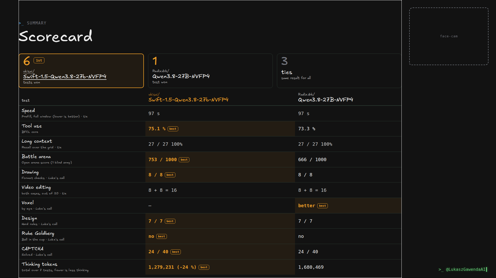
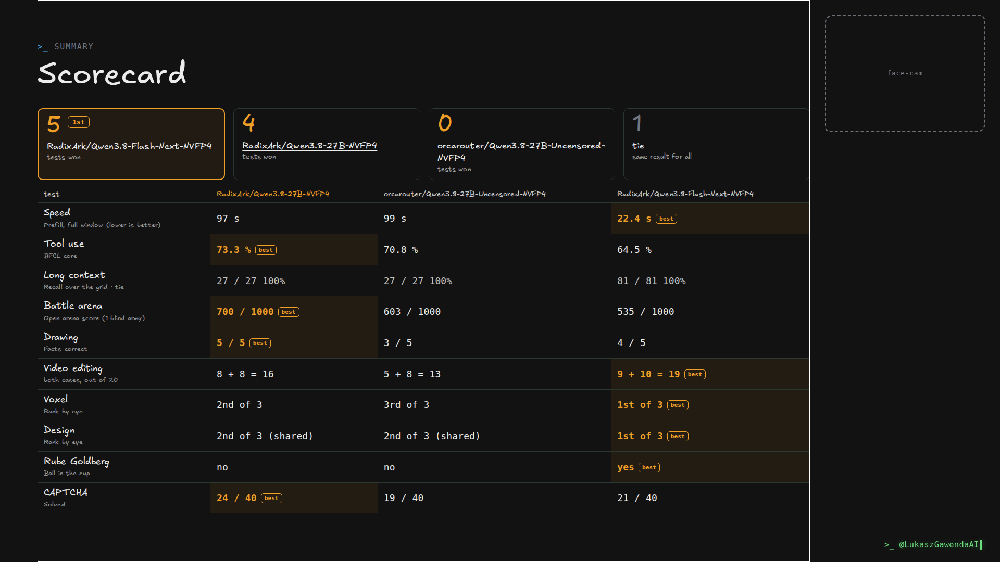

# RadixArk/Qwen3.8-27B-NVFP4

▶ **Video: [58% Less Thinking? Swift 1.5 vs Qwen 3.8 27B in 10 Real Tests!](https://www.youtube.com/watch?v=9WOEjWC9zYs)**  
▶ **Video: [Which Qwen 3.8 Should You Run? 27B vs Flash Next vs Uncensored in 10 Real Tests!](https://youtu.be/VOtfja_Toj4)**  

RadixArk/Qwen3.8-27B-NVFP4 on SGLang v0.5.20 with the DFlash2 drafter.

## Scorecard: 58% Less Thinking? Swift 1.5 vs Qwen 3.8 27B in 10 Real Tests!

In this video it won 1 of 10 tests (3 ties) against ukisai/Swift-1.5-Qwen3.8-27b-NVFP4.



| Test | ukisai/Swift-1.5-Qwen3.8-27b-NVFP4 | RadixArk/Qwen3.8-27B-NVFP4 |
|---|---:|---:|
| Speed <sub>Prefill, full window (lower is better)</sub> | 97 s | 97 s |
| Tool use <sub>BFCL core</sub> | **75.1 %** | 73.3 % |
| Long context <sub>Recall over the grid</sub> | 27 / 27 100% | 27 / 27 100% |
| Battle arena <sub>Open arena score (1 blind army)</sub> | **753 / 1000** | 666 / 1000 |
| Drawing <sub>Format checks · Luke's call</sub> | **8 / 8** | 8 / 8 |
| Video editing <sub>both cases, out of 20</sub> | 8 + 8 = 16 | 8 + 8 = 16 |
| Voxel <sub>by eye · Luke's call</sub> | - | **better** |
| Design <sub>Hard rules · Luke's call</sub> | **7 / 7** | 7 / 7 |
| Rube Goldberg <sub>Ball in the cup · Luke's call</sub> | **no** | no |
| CAPTCHA <sub>Solved · Luke's call</sub> | **24 / 40** | 24 / 40 |
| Thinking tokens <sub>total over 7 tests, fewer is less thinking</sub> | **1,279,231 (-24 %)** | 1,680,469 |

- One run per model per test, on the same SGLang v0.5.20 launch and DFlash2 drafter; only the checkpoint differs.
- Rows marked Luke's call were tied on the number (or judged by eye) and decided by Luke.
- Rube Goldberg: neither handed in a machine. Swift landed the ball on 6 of 30 tries before the 90 min cap; RadixArk/Qwen3.8-27B-NVFP4 landed it on 1 of 4, then its session ended after 38 min when a request after compaction asked for 32 tokens more than the 262,144-token window.

How each test works, and why it won or lost: [in the video](https://www.youtube.com/watch?v=9WOEjWC9zYs).

## Scorecard: Which Qwen 3.8 Should You Run? 27B vs Flash Next vs Uncensored in 10 Real Tests!

In this video it won 4 of 10 tests (1 tie) against orcarouter/Qwen3.8-27B-Uncensored-NVFP4 and RadixArk/Qwen3.8-Flash-Next-NVFP4.



| Test | RadixArk/Qwen3.8-27B-NVFP4 | orcarouter/Qwen3.8-27B-Uncensored-NVFP4 | RadixArk/Qwen3.8-Flash-Next-NVFP4 |
|---|---:|---:|---:|
| Speed <sub>Prefill, full window (lower is better)</sub> | 97 s | 99 s | **22.4 s** |
| Tool use <sub>BFCL core</sub> | **73.3 %** | 70.8 % | 64.5 % |
| Long context <sub>Recall over the grid</sub> | 27 / 27 100% | 27 / 27 100% | 81 / 81 100% |
| Battle arena <sub>Open arena score (1 blind army)</sub> | **700 / 1000** | 603 / 1000 | 535 / 1000 |
| Drawing <sub>Facts correct</sub> | **5 / 5** | 3 / 5 | 4 / 5 |
| Video editing <sub>both cases, out of 20</sub> | 8 + 8 = 16 | 5 + 8 = 13 | **9 + 10 = 19** |
| Voxel <sub>Rank by eye</sub> | 2nd of 3 | 3rd of 3 | **1st of 3** |
| Design <sub>Rank by eye</sub> | 2nd of 3 (shared) | 2nd of 3 (shared) | **1st of 3** |
| Rube Goldberg <sub>Ball in the cup</sub> | no | no | **yes** |
| CAPTCHA <sub>Solved</sub> | **24 / 40** | 19 / 40 | 21 / 40 |

- One run per model per test.
- Speed: Flash-Next's speed test ran at a 600 W GPU power cap, the 27B models' at 400 W. Prefill slows as the cap drops, so part of the gap is the cap.
- On the 27B, the DFlash2 drafter took Spec-Bench from 75 to 210 tok/s for one user (2.8x).

How each test works, and why it won or lost: [in the video](https://youtu.be/VOtfja_Toj4).

## Run it

```bash
docker compose up -d        # the first start downloads the weights
docker compose logs -f      # wait for: The server is fired up
curl -s http://127.0.0.1:8000/v1/models
```

It downloads [RadixArk/Qwen3.8-27B-NVFP4](https://huggingface.co/RadixArk/Qwen3.8-27B-NVFP4) at `319f741cce68`, [incoai/Qwen3.8-27B-DFlash2](https://huggingface.co/incoai/Qwen3.8-27B-DFlash2) at `015e795645c7` into `$HF_HOME` (default `~/.cache/huggingface`), the revisions that were measured. A gated model needs `HF_TOKEN` set and its terms accepted on Hugging Face. It serves on `127.0.0.1:8000` at the full window, so run one model at a time. The header of `compose.yaml` explains every value; change what you need for your card.

## Engine image

Measured with `lmsysorg/sglang:v0.5.20` (`sha256:06e4f2ed21afde4ff513cda65070124e727ba23ccaeff7712b8c40e1097d611f`), 2026-10-09.

Engines move fast. If you read this months later, try the newest image first: `SGLANG_IMAGE=lmsysorg/sglang:latest docker compose up -d`. The pinned image is the one the numbers come from.

## Things that bite

- The DFlash2 drafter is BF16: `--speculative-draft-model-quantization unquant` stops SGLang from applying the target model's FP4 quantization to it.
